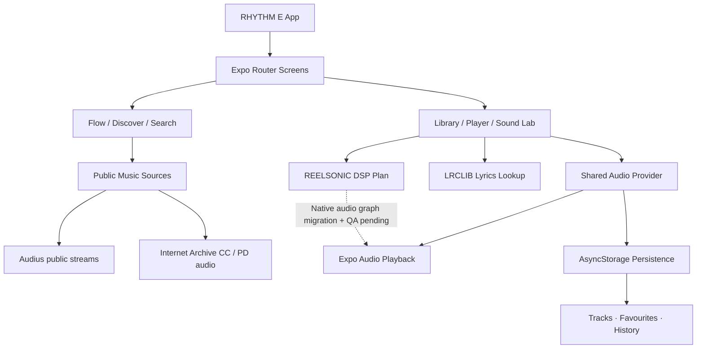

<div align="center">

# ◈ RHYTHM E

### THE SOUND OF YOUR OWN UNIVERSE.

**A futuristic, personal-first music experience.**  
Immersive listening • Vertical Flow • Your library • Your sound

<br/>

[](https://github.com/smrutiranjandev0p/RHYTHM-E/tree/development)
[](https://expo.dev/)
[](https://reactnative.dev/)
[](#)

<br/>

[ **EXPLORE THE PROJECT** ](https://github.com/smrutiranjandev0p/RHYTHM-E/tree/development)
&nbsp; ◈ &nbsp;
[ **FEATURE ROADMAP** ](docs/FEATURE_ROADMAP.md)
&nbsp; ◈ &nbsp;
[ **DSP ENGINE PLAN** ](docs/REELSONIC_DSP.md)

<br/>

*An independent music-player project with its own identity — inspired by the feeling of immersive, swipe-first music discovery.*

</div>

---

## ◉ 01 / THE VISION

RHYTHM E is being built around one simple idea: **your music should feel like your space.**

A premium dark interface, a vertical music Flow, a personal library and a sound-personalisation layer come together in one listening experience. The goal is to make moving between tracks, discovering music and returning to favourites feel fluid and immediate.

> **Not another music clone. A listening universe with its own rhythm.**

## ◉ 02 / EXPERIENCE MODULES

| MODULE | WHAT IT DOES | CURRENT STATE |
|:--|:--|:--:|
| **FLOW** | Vertical, swipe-first listening feed with animated artwork, playback progress and favourites | In development |
| **PLAYER CORE** | Shared playback queue, play/pause, skip, seek, automatic next track and in-app online tracks | Implemented; device QA pending |
| **MY LIBRARY** | Import audio into private app storage; keep favourites and recent plays | Implemented; device QA pending |
| **ARTIST / ALBUM SPACE** | Browse tracks by artist and album; edit title, artist and album metadata | Implemented; device QA pending |
| **DISCOVER** | Mood-led discovery with resilient multi-source online search | Audius + Internet Archive + Wikimedia Commons connected |
| **LYRICS** | LRCLIB lookup and timestamp-based synced-line highlighting when available | Connected; QA pending |
| **SOUND LAB** | REELSONIC preset and equalizer interface, plus sleep timer | UI preview; DSP not active |
| **INSIGHTS** | Recent listening and basic library insights | Prototype |
| **YOUTUBE HAND-OFF** | Opens official YouTube search in the YouTube app or website | Implemented; no in-app audio |

## ◉ 03 / THE VISUAL LANGUAGE

<div align="center">

| ◈ NEON PINK | ◈ DEEP VIOLET | ◈ NIGHT MODE |
|:--:|:--:|:--:|
| `#FF9CC4` | `#873E78` | `#160D1C` |
| Energy & interaction | Depth & atmosphere | Focus & immersion |

</div>

The interface is designed around a dark, atmospheric canvas with vivid accent lighting, rounded surfaces, animated abstract artwork and a mobile-first layout.

## ◉ 04 / SYSTEM ARCHITECTURE



### Technology constellation

| LAYER | TECHNOLOGY |
|:--|:--|
| Application | React Native 0.88 |
| Framework | Expo SDK 58 |
| Navigation | Expo Router |
| Audio playback | Expo Audio |
| Local persistence | AsyncStorage |
| File storage | Expo FileSystem — app-private Documents directory |
| Audio import | Expo Document Picker |
| Lyrics | LRCLIB API |
| Language | TypeScript |

## ◉ 05 / QUICK START

### Requirements

- Node.js compatible with the installed Expo SDK
- Git
- Android device or emulator
- Windows, macOS or Linux development computer

### Clone the development branch

```bash
git clone --branch development --single-branch https://github.com/smrutiranjandev0p/RHYTHM-E.git
cd RHYTHM-E
```

### Install dependencies

```bash
npm install
```

### Validate the project

```bash
npx expo install --check
npx expo-doctor
npm run typecheck
```

### Start the development server

```bash
npx expo start
```

**Native audio note:** Background playback and lock-screen behaviour must be verified in a native development build on a real device. Expo Go is not a substitute for validating the complete native audio experience. Do not treat a successful Metro start as proof that native playback works.

## ◉ 06 / DEVELOPMENT ROADMAP

| PHASE | MILESTONE | STATUS |
|:--:|:--|:--:|
| 01 | App foundation, navigation and visual identity | Built |
| 02 | Shared player, local library and persistence | Implemented; QA pending |
| 03 | Vertical Flow, discovery, lyrics and library browsing | Implemented in part; QA pending |
| 04 | Permanent audio storage and editable metadata | Added; QA pending |
| 05 | Native REELSONIC EQ / DSP engine | Planned |
| 06 | Playback reliability, accessibility and performance | Pending |
| 07 | Release builds and store-readiness checks | Pending |

The detailed plan and validation gates live in [FEATURE_ROADMAP.md](docs/FEATURE_ROADMAP.md).

## ◉ 07 / IMPORTANT ENGINEERING NOTES

- **Local files:** Audio selected by the user is copied into RHYTHM E's private app Documents storage. Clearing app data or uninstalling the app removes those private copies.
- **Older imports:** The app attempts to migrate older picker-cache tracks on startup when their original files are still accessible.
- **Persistence:** Track metadata, favourites and recent listening history are stored on-device. Restoring a selected track does not automatically start playback.
- **REELSONIC:** The equalizer controls and preset curves are currently design previews. No EQ, compressor, limiter or loudness processing is active in playback.
- **Online music:** RHYTHM E searches creator-published Audius streams, then licence-filtered Creative Commons/Public Domain audio from Internet Archive and Wikimedia Commons. The sources operate independently, so a failure in one does not empty a search. Audius availability is creator-controlled; archive and Commons licence metadata must be checked on the source page. These sources do not promise every commercial release.
- **YouTube:** RHYTHM E opens official YouTube search. It does not extract, relay, download or cache YouTube audio. NewPipeExtractor v0.27.1 is configured as an Android dependency for future permitted integrations; it is not currently used to resolve or play third-party streams.
- **Testing:** Dependency checks, typechecking, native builds and physical-device playback must be completed before calling this release-ready.

## ◉ 08 / MUSIC RIGHTS & RESPONSIBLE ACCESS

RHYTHM E is intended as a free-to-use, non-commercial project. That intention does not grant rights to copyrighted recordings or override a provider's terms.

The project currently uses:
- User-selected audio files the user is entitled to play.
- Public Audius streams that creators make available through the Audius API.
- Public-domain recordings.
- Creative Commons recordings whose specific licence permits the intended use.
- Official integrations and authorised music providers.

No unauthorised stream extraction, DRM circumvention, private API scraping or unauthorised downloading/caching is part of this project.

See:
- [Open music catalogue sources and validation checklist](docs/OPEN_MUSIC_CATALOGUE.md)
- [Free / non-commercial product direction](docs/LASTWAVE_INSPIRED_NONCOMMERCIAL_PLAN.md)
- [Licensed catalogue implementation notes](docs/LICENSED_CATALOGUE_IMPLEMENTATION.md)
- [REELSONIC DSP engineering plan](docs/REELSONIC_DSP.md)
- [Third-party software licences](docs/THIRD_PARTY_LICENSES.md)

## ◉ 09 / CONTRIBUTION & DEVELOPMENT RULES

RHYTHM E is actively evolving. Before proposing changes:

1. Work on the `development` branch.
2. Keep `main` stable; do not merge without release checks.
3. Preserve the shared audio queue and playback state.
4. Keep rights, attribution and provider restrictions explicit.
5. Never label a preview control as a working audio feature.
6. Include device-test notes for native audio changes.

## ◉ 10 / PROJECT STATUS

<div align="center">

### BUILT WITH INTENTION. TESTED WITH CARE. DESIGNED TO FEEL DIFFERENT.

**RHYTHM E** &nbsp; ◈ &nbsp; *Find your frequency. Keep it playing.*

<sub>Independent project • Development branch • November 2026</sub>

</div>
